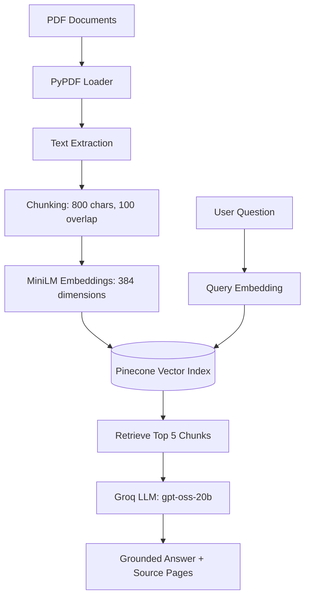

# PDF Question Answering with RAG

A Retrieval-Augmented Generation (RAG) application that enables users to ask questions about PDF documents and receive context-grounded answers with source page references.

The project uses local Hugging Face embeddings, Pinecone for vector search, and Groq-hosted LLM inference. The demonstration dataset is the Government of India's Union Budget 2023–24 speech, but the pipeline supports other text-based PDF documents.

## Features

- **Multi-PDF ingestion:** Load and process PDF files from the `documents/` directory.
- **Text chunking:** Split extracted content into 800-character chunks with 100-character overlap.
- **Local embeddings:** Generate 384-dimensional embeddings using `sentence-transformers/all-MiniLM-L6-v2` without a paid embedding API.
- **Vector search:** Store and retrieve document embeddings using a Pinecone serverless index with cosine similarity.
- **LLM-powered answers:** Use Groq-hosted `openai/gpt-oss-20b` to generate answers from retrieved document context.
- **Grounded responses:** Instruct the model to answer only from the supplied context and return an uncertainty response when the answer is unavailable.
- **Source attribution:** Report the PDF page numbers associated with retrieved passages.
- **Repeatable indexing:** Clear the existing index before ingestion to prevent stale or duplicate vectors from previous runs.
- **Runtime validation:** Check the existing Pinecone index dimension against the embedding model configuration.

## Architecture



### How It Works

1. **Document ingestion:** Load every PDF in `documents/` and extract its text and page metadata.
2. **Chunking:** Divide the extracted text into overlapping chunks to preserve local context.
3. **Embedding generation:** Convert each chunk into a 384-dimensional vector using the local MiniLM model.
4. **Vector indexing:** Store the vectors and associated metadata in Pinecone.
5. **Query processing:** Embed the user's question using the same embedding model.
6. **Retrieval:** Search Pinecone using cosine similarity and retrieve the five most relevant chunks.
7. **Answer generation:** Pass the retrieved passages and question to the Groq-hosted LLM with instructions to stay within the supplied context.
8. **Source reporting:** Return the generated answer alongside the relevant PDF page references.

## Tech Stack

| Component | Technology |
|---|---|
| Language | Python 3.11 |
| Development environment | Jupyter Notebook |
| Orchestration | LangChain |
| PDF processing | PyPDF / LangChain community integrations |
| Text splitting | LangChain Text Splitters |
| Embedding model | `sentence-transformers/all-MiniLM-L6-v2` |
| Embedding inference | Hugging Face Sentence Transformers |
| Vector database | Pinecone Serverless |
| Similarity metric | Cosine similarity |
| LLM inference | Groq API |
| Generation model | `openai/gpt-oss-20b` |
| Configuration | Python environment variables and `.env` |

## Project Structure

```text
pdf-qa-rag-pinecone/
├── documents/
│   └── budget_speech.pdf       # Example PDF document
├── pdf_qa_rag.ipynb            # End-to-end RAG pipeline
├── requirements.txt            # Python dependencies
├── .env.example                # Environment variable template
└── .gitignore                  # Excluded files and secrets
```

## Prerequisites

Before getting started, ensure you have:

- Python 3.11 installed.
- A Pinecone account and API key.
- A Groq account and API key.
- Internet connectivity for API requests and the initial embedding-model download.
- A text-based PDF document to index.

## Getting Started

### 1. Clone the Repository

```powershell
git clone https://github.com/Nisha-Lohar04/pdf-qa-rag-pinecone.git
cd pdf-qa-rag-pinecone
```

### 2. Create and Activate a Virtual Environment

```powershell
python -m venv venv
.\venv\Scripts\Activate.ps1
```

If PowerShell blocks script execution, activate the environment using the appropriate execution policy for your machine or run the virtual environment's Python executable directly.

### 3. Install Dependencies

```powershell
python -m pip install --upgrade pip
python -m pip install -r requirements.txt
```

### 4. Configure API Keys

Copy `.env.example` to `.env`:

```powershell
Copy-Item .env.example .env
```

Add your credentials to `.env`:

```dotenv
PINECONE_API_KEY=your_pinecone_api_key
GROQ_API_KEY=your_groq_api_key
```

Obtain your credentials from:

- [Pinecone Console](https://app.pinecone.io/)
- [Groq Console](https://console.groq.com/)

**Security:** Never commit `.env` or expose API keys in notebooks, source files, screenshots, or Git history. Ensure `.env` is included in `.gitignore`.

### 5. Add a PDF Document

Place your PDF files in the `documents/` directory. For the demonstration, download the Union Budget 2023–24 speech from the [official Union Budget website](https://www.indiabudget.gov.in/) and save it as:

```text
documents/budget_speech.pdf
```

You can also use other text-based PDFs. The document must contain extractable text for the current pipeline to work without OCR.

### 6. Run the Notebook

Start Jupyter Notebook from the activated virtual environment:

```powershell
python -m pip install notebook ipykernel
python -m ipykernel install --user --name pdf-qa-rag --display-name "Python (PDF QA RAG)"
python -m notebook
```

Open `pdf_qa_rag.ipynb`, select the **Python (PDF QA RAG)** kernel, and execute the cells in order.

On the first run, the embedding model is downloaded locally. Pinecone must also have an index configured with the expected embedding dimension and cosine similarity metric. The notebook's index-validation logic checks the dimension before ingestion.

## Usage

After the document ingestion and indexing steps have completed, submit a question using the notebook's answer-retrieval function:

```python
print(
    retrieve_answers(
        "How much will the agriculture credit target be increased to?"
    )
)
```

The pipeline retrieves relevant passages, generates an answer using the Groq-hosted model, and reports the associated PDF page references.

### Example Questions

The following questions can be used with the Union Budget 2023–24 speech:

| Question | Expected Answer |
|---|---|
| How much will the agriculture credit target be increased to? | ₹20 lakh crore |
| What is the capital investment outlay for 2023–24? | ₹10 lakh crore |
| What is the new rebate limit under the new tax regime? | ₹7 lakh |
| What is the estimated fiscal deficit for 2023–24? | 5.9% of GDP |

These are example answers from the budget speech, not a formal evaluation of the retrieval or generation pipeline. Actual responses depend on successful retrieval and the model's output.

## Design Decisions

### 1. Local Embeddings

The `all-MiniLM-L6-v2` model generates 384-dimensional embeddings locally. This avoids dependence on a paid embedding API and keeps the embedding-generation step on the local machine. The document text is still sent to the configured Groq API when retrieved context is used for answer generation.

### 2. Chunk Size and Overlap

The pipeline uses 800-character chunks with a 100-character overlap. Overlap helps preserve context across chunk boundaries. MiniLM has a maximum sequence length of 256 tokens, so the effective input can be truncated for some chunks; character count alone does not guarantee that every chunk fits within the model's token limit.

### 3. Context-Grounded Generation

The generation prompt instructs the LLM to answer using the retrieved passages, preserve numerical values and units, and indicate when the available context does not contain the answer. This reduces unsupported responses but does not guarantee that hallucinations will never occur.

### 4. Vector Index Validation

The embedding dimension is checked against the existing Pinecone index configuration. This helps detect incompatible indexes before vectors are uploaded or queried.

### 5. Repeatable Indexing

The current workflow clears the existing index before uploading new document vectors. This avoids accumulation across repeated runs, but it also removes previously indexed data. Use a dedicated development index and avoid running this workflow against an index shared by other applications.

## Limitations

- **Prototype scope:** Designed for learning and experimentation rather than production deployment.
- **Text-based PDFs only:** Scanned documents require OCR before text extraction.
- **Table extraction:** Complex tables, columns, headers, and footnotes may not be preserved accurately.
- **Chunking strategy:** Character-based chunking does not account for sentence boundaries or model token limits.
- **Vector-only retrieval:** Semantic similarity can miss exact keywords and may be insufficient for document-wide summaries.
- **Answer reliability:** Prompt instructions alone cannot guarantee factual correctness or complete abstention when context is insufficient.
- **Evaluation:** No automated benchmark currently measures retrieval quality, answer correctness, or citation accuracy.
- **External services:** Pinecone and Groq require network connectivity and valid credentials; Groq usage is subject to the provider's current model availability and limits.

## Future Improvements

- Implement hybrid retrieval combining keyword search and vector similarity.
- Add a cross-encoder re-ranker to improve the relevance of retrieved passages.
- Build a test set with expected answers and supporting page references.
- Evaluate retrieval and generation separately using metrics such as Recall@k, MRR, answer correctness, and citation accuracy.
- Add OCR support for scanned PDFs.
- Improve PDF parsing for tables, multi-column layouts, and document structure.
- Develop a Streamlit or FastAPI interface for interactive question answering.
- Add document-level namespaces or metadata filters to support multiple collections safely.
- Replace destructive index clearing with scoped deletion or versioned indexing.
- Add structured citations containing document names, page numbers, and retrieved excerpts.

ha-Lohar04)
- Repository: [PDF Question Answering with RAG](https://github.com/Nisha-Lohar04/pdf-qa-rag-pinecone)
